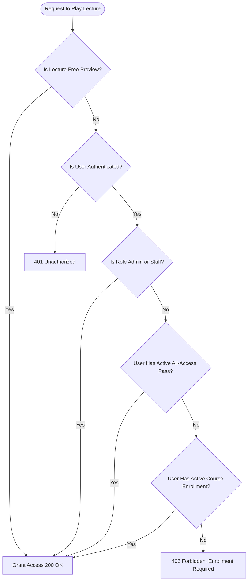

# Phase 1: Video Engine, Course Curriculum & Secure Playback Integration
## Comprehensive Technical Implementation Plan

> **Project:** Neha's Institute — Culinary Video-Lecture Platform  
> **Status:** Draft / Ready for User Approval  
> **Target Branch:** `main`  
> **Pre-requisite:** Phase 0 (Hygiene, Rebranding & UI Foundations) COMPLETED ✅  

---

## 1. Executive Summary & Goals

Phase 0 established a clean, rebranded codebase, purged TET-exam remnants, and built a mobile-first UI with luxury culinary aesthetic tokens. However, the courses and watch player currently run on static mock data.

**The primary objective of Phase 1 is to activate the real course & video engine:**
1. **Database Layer:** Add `Course`, `Section`, `Lecture`, `Enrollment`, and `LectureProgress` to Prisma, generate migration SQL, inspect it, and apply it to Neon.
2. **Video Streaming Service:** Build a robust, decoupled Bunny Stream adapter (`services/bunny.ts`) featuring SHA-256 Token Authentication, signed playback URL generation, and an automatic local mock provider for friction-free local development.
3. **API & Access Control:** Implement public catalog endpoints, protected syllabus detail, admin curriculum CRUD, and the core security guard `canWatchLecture()` that validates entitlements before minting signed playback tokens.
4. **Player & Frontend Integration:** Wire the existing web pages (`/courses`, `/courses/[slug]`, and `/courses/[slug]/watch`) to live backend APIs, enabling seamless video streaming, tab navigation, and automated watch progress tracking.

---

## 2. Database Schema Expansion (`apps/api/prisma/schema.prisma`)

### 2.1 New Enums & Models

We will append the video & enrollment layer to the baseline schema. Note that we define `Enrollment` and `LectureProgress` now so foreign keys (`Payment.courseId`, `Note.courseId`, `Note.lectureId`) have full relational integrity without orphan strings.

```prisma
// ─── Video & Course Enums ──────────────────────────────────────────────────────

enum VideoStatus {
  UPLOADING
  PROCESSING
  READY
  FAILED
}

enum CourseLevel {
  BEGINNER
  INTERMEDIATE
  ADVANCED
}

// ─── Course & Curriculum Models ────────────────────────────────────────────────

model Course {
  id               String       @id @default(cuid())
  slug             String       @unique
  title            String
  description      String       @db.Text
  shortDescription String?
  category         String       // e.g. "Regional Indian", "Baking & Pastry", "Street Classics"
  level            CourseLevel  @default(BEGINNER)
  thumbnailKey     String?      // R2 / S3 object key
  previewVideoId   String?      // Bunny Video GUID for public trailer (optional)
  priceInPaise     Int          // e.g. 49900 = ₹499 (0 = free course)
  isPublished      Boolean      @default(false)
  order            Int          @default(0)
  createdAt        DateTime     @default(now())
  updatedAt        DateTime     @updatedAt

  sections         Section[]
  enrollments      Enrollment[]
  payments         Payment[]    @relation("CoursePayments")
  resources        Note[]       @relation("CourseNotes")

  @@index([isPublished, category])
  @@index([slug])
}

model Section {
  id        String    @id @default(cuid())
  courseId  String
  title     String
  order     Int       @default(0)
  course    Course    @relation(fields: [courseId], references: [id], onDelete: Cascade)
  lectures  Lecture[]
  createdAt DateTime  @default(now())
  updatedAt DateTime  @updatedAt

  @@index([courseId, order])
}

model Lecture {
  id            String            @id @default(cuid())
  sectionId     String
  title         String
  description   String?           @db.Text
  order         Int               @default(0)
  videoId       String?           // Bunny Video GUID — CRITICAL: NEVER return in public API
  durationSec   Int?              @default(0)
  status        VideoStatus       @default(UPLOADING)
  isFreePreview Boolean           @default(false)
  section       Section           @relation(fields: [sectionId], references: [id], onDelete: Cascade)
  progress      LectureProgress[]
  resources     Note[]            @relation("LectureNotes")
  createdAt     DateTime          @default(now())
  updatedAt     DateTime          @updatedAt

  @@index([sectionId, order])
}

// ─── Enrollment & Progress Models ──────────────────────────────────────────────

model Enrollment {
  id        String    @id @default(cuid())
  userId    String
  courseId  String
  paymentId String?   @unique
  expiresAt DateTime? // null = lifetime access
  createdAt DateTime  @default(now())

  user      User      @relation(fields: [userId], references: [id], onDelete: Cascade)
  course    Course    @relation(fields: [courseId], references: [id], onDelete: Cascade)

  @@unique([userId, courseId])
  @@index([userId])
  @@index([courseId])
}

model LectureProgress {
  userId      String
  lectureId   String
  positionSec Int      @default(0)
  completed   Boolean  @default(false)
  updatedAt   DateTime @updatedAt

  user        User     @relation(fields: [userId], references: [id], onDelete: Cascade)
  lecture     Lecture  @relation(fields: [lectureId], references: [id], onDelete: Cascade)

  @@id([userId, lectureId])
  @@index([userId])
}
```

### 2.2 Relational Updates to Existing Models

- **`User`**: Add relations `enrollments Enrollment[]` and `lectureProgress LectureProgress[]`.
- **`Payment`**: Connect `courseId` relation:
  ```prisma
  course   Course? @relation("CoursePayments", fields: [courseId], references: [id], onDelete: SetNull)
  ```
- **`Note`**: Connect optional `courseId` and `lectureId` relations:
  ```prisma
  course   Course?  @relation("CourseNotes", fields: [courseId], references: [id], onDelete: SetNull)
  lecture  Lecture? @relation("LectureNotes", fields: [lectureId], references: [id], onDelete: SetNull)
  ```

### 2.3 Migration Protocol & Safety Lock

> [!IMPORTANT]
> **Strict Migration Rule:**
> 1. Run `npx prisma migrate dev --create-only --name add_courses_and_video_layer`
> 2. STOP and display the generated SQL migration file to the user.
> 3. Verify `DATABASE_URL` and `DIRECT_URL` point to the new Neon instance.
> 4. Only after user approval, run `npx prisma migrate deploy`.

---

## 3. Bunny Stream Video Infrastructure (`apps/api/src/services/bunny.ts`)

### 3.1 Security Model

Bunny Stream stores and transcodes master videos into multi-bitrate HLS streams (`.m3u8` / `.mp4`). To protect premium culinary content:
1. **Direct MP4 Download Disabled:** Disabled in Bunny Library settings.
2. **Domain Referrer Whitelist:** Configured to `nehainstitute.in` and `localhost:3000`. Requests without a matching `Referer` header are rejected with HTTP 403.
3. **SHA-256 Token Authentication:** The master video URL cannot be played directly. The backend computes a time-limited HMAC/SHA-256 token hash:
   $$\text{hash} = \text{SHA256}(\text{BUNNY\_TOKEN\_AUTH\_KEY} + \text{videoId} + \text{expiresAt})$$
   $$\text{token} = \text{base64url}(\text{hash})$$
4. **Embed URL Pattern:**
   `https://iframe.mediadelivery.net/embed/{libraryId}/{videoId}?token={token}&expires={expires}`
5. **Zero VideoId Leakage Principle:** Public endpoints (`/api/courses`, `/api/courses/:slug`) **never** return `videoId`. Only the authenticated, entitlement-verified endpoint `GET /api/lectures/:id/play` yields an ephemeral signed iframe URL.

### 3.2 Service Architecture

We structure `bunny.ts` around a TypeScript interface `VideoProvider` to ensure modularity and zero-cost local development:

```typescript
export interface VideoSignedUrlOptions {
  videoId: string;
  expiresInSeconds?: number; // default 14400 (4 hours)
}

export interface VideoProvider {
  generateSignedEmbedUrl(options: VideoSignedUrlOptions): Promise<string>;
  createVideoRecord(title: string): Promise<{ videoId: string }>;
  generateTusUploadAuth(videoId: string): Promise<{
    uploadUrl: string;
    signature: string;
    expirationTime: number;
    libraryId: string;
    videoId: string;
  }>;
  getVideoStatus(videoId: string): Promise<{ status: VideoStatus; durationSec: number }>;
}
```

- When `BUNNY_API_KEY` or `BUNNY_LIBRARY_ID` is unset (e.g. in test or fresh dev clone), the service transparently falls back to `MockVideoProvider`, providing standard open culinary sample streams without throwing errors.

---

## 4. Access Control Engine (`apps/api/src/middleware/canWatch.ts`)

Every request to play a lecture must pass through an entitlement evaluation before any video URL or token is generated.

### 4.1 Entitlement Decision Matrix



### 4.2 Implementation Contract

```typescript
export interface CanWatchResult {
  allowed: boolean;
  reason?: 'FREE_PREVIEW' | 'STAFF' | 'ALL_ACCESS_PLAN' | 'ENROLLED' | 'UNAUTHORIZED' | 'PAYWALL';
}

export async function canWatchLecture(
  user: { userId: string; role: Role; plan: Plan; planExpiresAt?: Date | null } | null | undefined,
  lectureId: string
): Promise<CanWatchResult> {
  const lecture = await prisma.lecture.findUnique({
    where: { id: lectureId },
    select: {
      id: true,
      isFreePreview: true,
      section: { select: { courseId: true } },
    },
  });

  if (!lecture) return { allowed: false, reason: 'PAYWALL' };
  if (lecture.isFreePreview) return { allowed: true, reason: 'FREE_PREVIEW' };
  if (!user) return { allowed: false, reason: 'UNAUTHORIZED' };

  if (['SUPER_ADMIN', 'CONTENT_MANAGER', 'SUPPORT_MANAGER'].includes(user.role)) {
    return { allowed: true, reason: 'STAFF' };
  }

  if (user.plan === 'PAID' && user.planExpiresAt && new Date(user.planExpiresAt) > new Date()) {
    return { allowed: true, reason: 'ALL_ACCESS_PLAN' };
  }

  const enrollment = await prisma.enrollment.findUnique({
    where: {
      userId_courseId: {
        userId: user.userId,
        courseId: lecture.section.courseId,
      },
    },
    select: { expiresAt: true },
  });

  if (enrollment && (!enrollment.expiresAt || new Date(enrollment.expiresAt) > new Date())) {
    return { allowed: true, reason: 'ENROLLED' };
  }

  return { allowed: false, reason: 'PAYWALL' };
}
```

---

## 5. API Endpoints Specification

### 5.1 Public & Student Course Endpoints (`apps/api/src/routes/courses.ts`)

| Method | Path | Auth | Description | Response Shape |
| :--- | :--- | :--- | :--- | :--- |
| `GET` | `/api/courses` | Optional | Course catalog with filters (category, search, level) | `{ data: CourseSummary[] }` |
| `GET` | `/api/courses/:slug` | Optional | Course detail, syllabus sections & lecture headers (no `videoId`) + user enrollment status | `{ data: CourseDetail }` |
| `GET` | `/api/courses/:id/progress` | `requireAuth` | Student progress stats for the course | `{ totalLectures, completedCount, percentComplete, lastWatchedLectureId }` |

### 5.2 Video Playback & Tracking (`apps/api/src/routes/lectures.ts`)

| Method | Path | Auth | Description | Response Shape |
| :--- | :--- | :--- | :--- | :--- |
| `GET` | `/api/lectures/:id/play` | Optional (Free preview supported) | Evaluates entitlement; returns signed embed URL | `{ embedUrl: string, expiresAt: number, lecture: { id, title, durationSec } }` |
| `POST` | `/api/lectures/:id/progress` | `requireAuth` | Upserts playback timestamp (`positionSec`) & `completed` flag | `{ ok: true, progress: LectureProgress }` |

### 5.3 Admin Curriculum Management (`apps/api/src/routes/admin/courses.ts`)

| Method | Path | Auth | Description |
| :--- | :--- | :--- | :--- |
| `GET` | `/api/admin/courses` | `requireAdmin` | Full list of courses (published & drafts) with enrollment stats |
| `POST` | `/api/admin/courses` | `requireAdmin` | Create new course draft |
| `PUT` | `/api/admin/courses/:id` | `requireAdmin` | Update course details, pricing, publish status |
| `DELETE` | `/api/admin/courses/:id` | `requireAdmin` | Archive/delete course |
| `POST` | `/api/admin/courses/:id/sections` | `requireAdmin` | Add section to syllabus |
| `POST` | `/api/admin/sections/:id/lectures` | `requireAdmin` | Add lecture to section |
| `PUT` | `/api/admin/curriculum/reorder` | `requireAdmin` | Batch reorder sections & lectures |
| `POST` | `/api/admin/lectures/:id/upload-auth`| `requireAdmin` | Generate Bunny TUS direct upload credentials |

---

## 6. Shared Package Expansion (`packages/shared`)

### 6.1 New Zod Schemas (`packages/shared/src/schemas.ts`)

```typescript
export const CourseQuerySchema = z.object({
  category: z.string().optional(),
  level: z.enum(['BEGINNER', 'INTERMEDIATE', 'ADVANCED']).optional(),
  search: z.string().optional(),
  page: z.coerce.number().int().min(1).default(1),
  limit: z.coerce.number().int().min(1).max(50).default(20),
});

export const CreateCourseSchema = z.object({
  title: z.string().min(3).max(200),
  slug: z.string().min(3).max(100).regex(/^[a-z0-9-]+$/),
  description: z.string().min(10),
  shortDescription: z.string().max(300).optional(),
  category: z.string().min(2),
  level: z.enum(['BEGINNER', 'INTERMEDIATE', 'ADVANCED']).default('BEGINNER'),
  priceInPaise: z.number().int().min(0),
  isPublished: z.boolean().default(false),
});

export const CreateSectionSchema = z.object({
  title: z.string().min(2).max(200),
  order: z.number().int().default(0),
});

export const CreateLectureSchema = z.object({
  title: z.string().min(2).max(200),
  description: z.string().optional(),
  order: z.number().int().default(0),
  isFreePreview: z.boolean().default(false),
});

export const UpdateLectureProgressSchema = z.object({
  positionSec: z.number().int().min(0),
  completed: z.boolean().optional(),
});
```

---

## 7. Frontend Integration (`apps/web`)

### 7.1 React Query Hooks

We create standardized client hooks in `apps/web/hooks/`:
- `useCourses(filters)`: Queries `GET /api/courses` with search, category filtering, and caching.
- `useCourse(slug)`: Queries `GET /api/courses/:slug` returning sections, lectures, and resources.
- `useLecturePlay(lectureId)`: Queries `GET /api/lectures/:id/play` to retrieve the signed iframe URL.
- `useLectureProgress(courseId)`: Manages local & server watch progress with optimistic updates.

### 7.2 Connecting the Watch Page (`apps/web/app/courses/[slug]/watch/page.tsx`)

1. **Replace Mock `LESSONS` with Dynamic Data:**
   - Fetch course data via `useCourse(slug)`.
   - Map sections and lectures to the sidebar navigation.
2. **Iframe Video Embed:**
   - Instead of a mock black box, render:
     ```tsx
     <iframe
       src={playData.embedUrl}
       loading="lazy"
       className="w-full h-full rounded-2xl border border-stone-800"
       allow="accelerometer; gyroscope; autoplay; encrypted-media; picture-in-picture"
       allowFullScreen
     />
     ```
3. **Automated Heartbeat Progress Saving:**
   - Use `window.addEventListener('message')` to receive Bunny Player `timeupdate` and `ended` events.
   - Throttled call every 15 seconds to `POST /api/lectures/:id/progress`.
   - On video completion: automatically mark lecture complete and prompt "Next Lesson".

---

## 8. Seed Data & Local Development

We create `apps/api/prisma/seed-courses.ts` with authentic masterclasses for Neha's Institute:
1. **Mastering Restaurant-Style Indian Gravies** (12 lessons across 3 modules, ₹499)
2. **Artisan Sourdough & Crusty Breads** (10 lessons, ₹699)
3. **Mithai & Traditional Indian Sweets Masterclass** (8 lessons, ₹399)
4. **Street Classics: Chaats, Rolls & Fast Food** (6 lessons, Free Preview Course)

Each course includes full curriculum, realistic lesson titles, cooking durations, and recipe PDF links.

---

## 9. Step-by-Step Execution Plan & Checkpoints

```
[Commit 1] feat(db): expand prisma schema with Course, Section, Lecture, Enrollment & Progress
           Action: Generate migration SQL. STOP. Display SQL for user verification.
           Checkpoint: User approves SQL. Run migration on Neon.

[Commit 2] feat(shared): export course and lecture schemas & types in @neha/shared
           Checkpoint: npm run build in packages/shared succeeds.

[Commit 3] feat(api): implement Bunny Stream adapter with signed URL generator & mock fallback
           Checkpoint: Unit test services/__tests__/bunny.test.ts passes.

[Commit 4] feat(api): implement canWatchLecture access control & unit tests
           Checkpoint: Unit test middleware/__tests__/canWatch.test.ts verifies all 6 entitlement branches.

[Commit 5] feat(api): implement public course & syllabus routes (GET /api/courses, GET /api/courses/:slug)
           Checkpoint: Integration test verifies public access and videoId exclusion.

[Commit 6] feat(api): implement lecture playback & progress routes (GET /play, POST /progress)
           Checkpoint: Endpoint returns signed embed token for free preview and 403 for locked content.

[Commit 7] feat(api): implement seed-courses script with realistic masterclasses
           Checkpoint: Database populated with 4 masterclasses and 36 structured lessons.

[Commit 8] feat(web): wire courses catalog, course detail, and watch player to live backend
           Checkpoint: Next.js build succeeds; test playback and progress persistence in browser.
```

---

## 10. Manual QA & Acceptance Checklist

- [ ] Guest can browse `/courses` and filter by category.
- [ ] Guest can open `/courses/mastering-restaurant-style-indian-gravies` and view the full syllabus.
- [ ] In syllabus, `videoId` is nowhere in the API response or HTML source.
- [ ] Guest can click a Free Preview lesson and watch it in the player.
- [ ] Guest clicking a locked lesson receives the paywall modal with "Enroll Now".
- [ ] Logged-in student with Paid Plan or Enrollment can stream all lessons seamlessly.
- [ ] Watching a lesson updates the progress bar and persists completion state upon reload.
- [ ] Refreshing or reopening the page resumes from the saved position.
- [ ] Direct inspection of the Bunny iframe URL confirms it includes a short-lived signed token.

---

> **Action required:** Please review this implementation plan. Once you confirm, we will proceed starting with **Step 1 (Prisma Schema update & migration SQL inspection)**.
